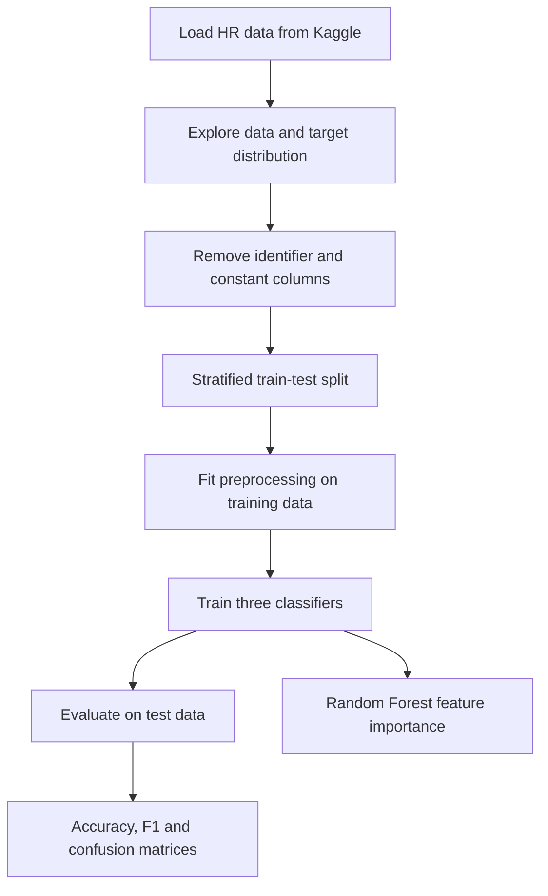

<div align="center">

# Employee Attrition Prediction

**Machine learning for workforce analytics | Open-ended academic lab**


[Explore the notebook](LAB07_OPEN_ENDED.ipynb) · [Dataset on Kaggle](https://www.kaggle.com/datasets/pavansubhasht/ibm-hr-analytics-attrition-dataset) · [Reproducibility notes](docs/reproducibility.md)

</div>

## Overview

Employee attrition refers to employees leaving an organization. This academic machine learning project explores whether employee characteristics can predict attrition using binary classification. It compares three supervised learning algorithms and examines model performance and feature importance.

## Results at a glance

| Employees | Original columns | Training records | Test records |
| ---: | ---: | ---: | ---: |
| 1,470 | 35 | 1,176 | 294 |

| Model | Test accuracy | F1-score (attrition class) |
| --- | ---: | ---: |
| **Logistic Regression** | **86.05%** | **0.4384** |
| Decision Tree | 83.67% | 0.2727 |
| Random Forest | 85.03% | 0.2414 |

These numbers are taken from the saved notebook outputs, not a new benchmark. Logistic Regression achieved the highest accuracy and F1-score in this experiment. The relatively low F1 scores indicate that identifying employees who leave remains challenging.

## Dataset

The notebook downloads the IBM HR Analytics Employee Attrition dataset via KaggleHub from the Kaggle dataset linked above, using `WA_Fn-UseC_-HR-Employee-Attrition.csv`.

- Target: `Attrition` (No = 0, Yes = 1).
- Distribution: 1,233 stayed and 237 left; approximately 16.1% positive cases.
- Predictors after exclusions: 23 numerical and 7 categorical columns.
- Examples: monthly income, overtime, job satisfaction, department, years at company and work-life balance.
- The saved dataset inspection reports no missing values.

The source dataset is not bundled with this repository. Review its terms before redistribution.

## Project workflow



### Methodology

1. Inspect dataset types, summary statistics, missing values and target distribution.
2. Remove the target from predictors along with EmployeeCount, EmployeeNumber, Over18 and StandardHours.
3. Split the data into 80% training and 20% testing with stratification and random state 42.
4. Apply median imputation and standard scaling to numerical features; apply most-frequent imputation and one-hot encoding to categorical features. Preprocessing is fitted inside each model pipeline.
5. Train Logistic Regression (max iterations 1,000), Decision Tree (maximum depth 5) and Random Forest (100 trees).
6. Compare accuracy, positive-class F1 and confusion matrices; visualize the top 15 Random Forest feature importances.

## Getting started

Install Python in a clean environment (Python 3.11 is a suggested starting point).

```bash
git clone https://github.com/alimuhammadbrohi2006/employee-attrition-ml.git
cd employee-attrition-ml
python -m venv .venv
```

Activate the environment:

Windows PowerShell: `.venv\Scripts\Activate.ps1`

macOS/Linux: `source .venv/bin/activate`

```bash
python -m pip install -r requirements.txt
jupyter notebook LAB07_OPEN_ENDED.ipynb
```

Select the environment's Python kernel and run all cells in order. Internet access is needed for the dataset; Kaggle authentication may be required. Alternatively, upload the notebook to Google Colab and install the dependencies there. See the [reproducibility guide](docs/reproducibility.md) for compatibility notes.

## Repository structure

```text
employee-attrition-ml/
├── LAB07_OPEN_ENDED.ipynb   # Analysis, training and visualizations
├── README.md               # Project overview and instructions
├── requirements.txt        # Notebook dependencies
├── .gitignore              # Local environments and credentials
└── docs/
    └── reproducibility.md  # Dataset and evaluation notes
```

## Limitations and future work

- Accuracy alone is misleading on imbalanced data: a majority-class baseline on the full dataset is approximately 83.9%.
- Results use a single holdout split; cross-validation, precision-recall analysis and threshold tuning are useful next steps.
- Random Forest feature importance is not evidence of causality.
- The notebook includes demographic features; fairness, privacy and generalization require evaluation before real-world use.
- This is an educational experiment, not a validated HR decision system. Do not use predictions to make individual employment decisions.
- No deployed application or serialized model is included.

## Author

**Ali Muhammad** — BS Artificial Intelligence student, Dawood University of Engineering and Technology.

Open-ended Machine Learning Lab 07.

[GitHub profile](https://github.com/alimuhammadbrohi2006)

## License and attribution

Dataset attribution: IBM HR Analytics Employee Attrition dataset, distributed via Kaggle by pavansubhasht. No software license is currently supplied; contact the repository owner before reusing or redistributing the code.
